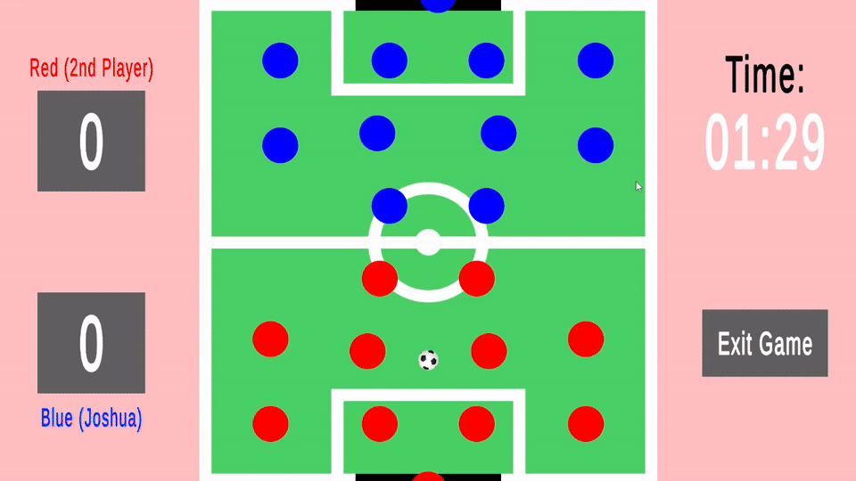
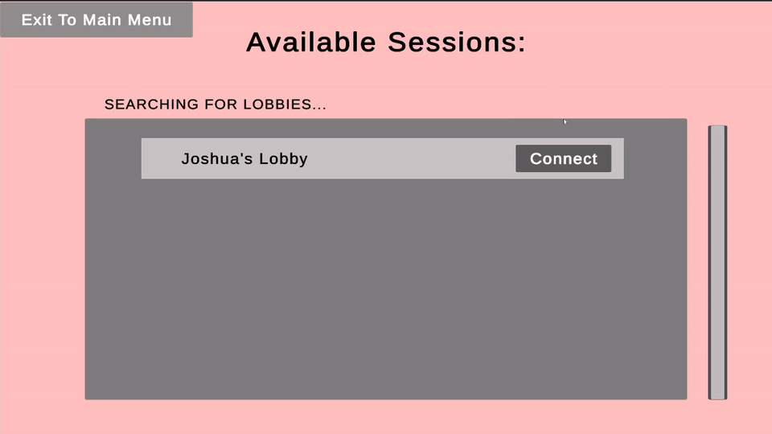
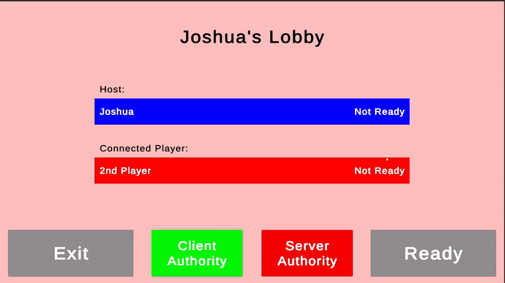
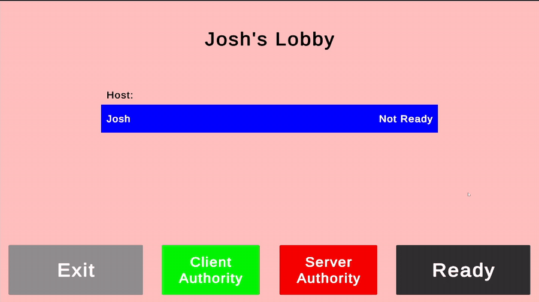
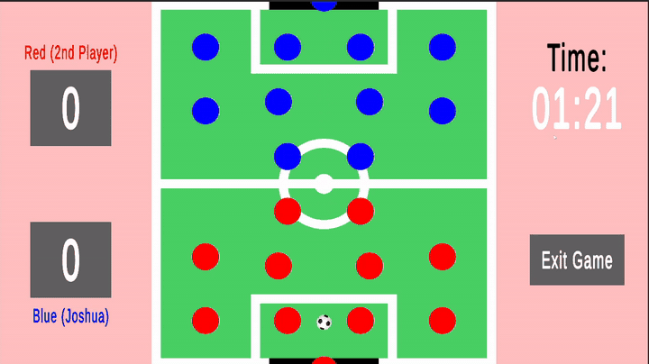

# Local Networked Table Football

**Unity | C# | Netcode for GameObjects | Unity Transport | UDP Networking**

A 2D top-down multiplayer table-football game developed in Unity as my individual Computer Science Honours project at the University of Hull.

The project focuses on local-network multiplayer architecture, LAN lobby discovery, custom gameplay synchronisation, configurable authority models, and the measurement of network behaviour.



## Project Background

This project was developed as my individual Honours project.

The main aim was to design and evaluate a responsive local multiplayer game running across devices on the same network. A major focus of my work was the gameplay networking layer: I developed the systems used to synchronise player-controlled rods and the football, created a shared tick-based update model, and implemented different authority and synchronisation approaches so their effect on responsiveness and consistency could be compared.

Alongside the gameplay networking, I developed the systems required to discover hosts, establish connections, manage a multiplayer lobby, handle disconnections, and collect runtime networking metrics. This allowed the different synchronisation approaches to be evaluated through measured behaviour as well as visual testing.

## Technical Overview

### LAN Discovery and Connection

The game uses UDP communication to allow clients to discover available hosts on the local network.

The host listens for discovery messages and validates the expected game ID, protocol version, and message type before returning the lobby details required by a client to connect. Unity Transport is then used for the actual multiplayer connection.



Relevant code:

- [`NetworkedLobbyManager.cs`](Assets/Scripts/Menu%20Scripts/GameLobbyScripts/NetworkedLobbyManager.cs) - host setup, UDP discovery responses, protocol validation, and Unity Transport configuration.
- [`PersistentLobbySessionManager.cs`](Assets/Scripts/Menu%20Scripts/PersistentLobbySessionManager.cs) - stores persistent session information including player names, lobby details, IP address, port, host/client state, authority mode, and disconnection state.
- [`LobbyOptionsSceneManager.cs`](Assets/Scripts/Menu%20Scripts/LobbyOptionsSceneManager.cs) - handles the flow between creating and joining LAN lobbies.

### Multiplayer Lobby

The lobby is server-controlled and synchronises each player's ready state before allowing the game scene to load.

A networked lobby state tracks whether the game is waiting for players, ready to begin, or connecting to the match. The server also controls a synchronised countdown so both players transition into the game consistently.



Relevant code:

- [`LobbyStateManager.cs`](Assets/Scripts/Menu%20Scripts/GameLobbyScripts/LobbyStateManager.cs) - networked ready states, lobby state transitions, synchronised countdown timing, and game-scene loading.
- [`GameSceneLoadCountdownEvent.cs`](Assets/Scripts/Menu%20Scripts/GameLobbyScripts/GameSceneLoadCountdownEvent.cs) - networked countdown event data.
- [`GameSceneLoadEventBus.cs`](Assets/Scripts/Menu%20Scripts/GameLobbyScripts/GameSceneLoadEventBus.cs) - distributes scene-load countdown events to the relevant UI/game systems.
- [`LoadGameSceneUICountdownManager.cs`](Assets/Scripts/Menu%20Scripts/GameLobbyScripts/LoadGameSceneUICountdownManager.cs) - displays the synchronised game-start countdown.

### Network Authority

The project supports different rod-authority configurations so that the effect of authority placement on responsiveness and consistency can be evaluated.

The selected authority mode is controlled by the host in the lobby and synchronised to the connected client before gameplay begins.



Relevant code:

- [`LobbyRodAuthorityManager.cs`](Assets/Scripts/Menu%20Scripts/GameLobbyScripts/LobbyRodAuthorityManager.cs) - selects and synchronises the rod authority mode between host and client.
- [`PersistentLobbySessionManager.cs`](Assets/Scripts/Menu%20Scripts/PersistentLobbySessionManager.cs) - persists the selected authority configuration between scenes.

### Gameplay Networking Architecture

The gameplay networking was a central technical part of the project. Rather than relying only on automatic transform synchronisation, I implemented a custom tick, snapshot, interpolation and reconciliation system for the player-controlled rods and football.

#### Network Tick System

Gameplay synchronisation is driven by a custom network tick system running at **30 Hz**.

The server establishes a shared start time and advances an authoritative tick counter. Clients estimate the current server tick from synchronised network time and generate their own client ticks, with a limited catch-up mechanism if they fall behind. Server and client tick events are then distributed through an event bus to the gameplay networking systems.

This provides a consistent timeline for input snapshots, authoritative state snapshots, interpolation and reconciliation.

Relevant code:

- [`NetworkTickManager.cs`](Assets/Scripts/Gameplay%20Scripts/Network%20Tick%20Scripts/NetworkTickManager.cs) - maintains the 30 Hz server/client tick timeline, predicts the current server tick, and converts time delays into tick offsets.
- [`NetworkTickEvent.cs`](Assets/Scripts/Gameplay%20Scripts/Network%20Tick%20Scripts/NetworkTickEvent.cs) - represents a gameplay network tick.
- [`NetworkTickEventBus.cs`](Assets/Scripts/Gameplay%20Scripts/Network%20Tick%20Scripts/NetworkTickEventBus.cs) - distributes server and client tick events to networking systems.

#### Rod Networking and Authority

Rod movement supports both **server-authoritative** and **client-authoritative** configurations. The selected mode is chosen in the lobby and applied to the gameplay objects so the two approaches can be compared using the same game.

For network transmission, rod positions and player inputs are quantised before being serialised. Rod positions are represented using a scaled `short`, while movement input is reduced to a signed byte. Tick IDs are included with snapshots so older state can be rejected.

In **server-authoritative mode**, player movement is applied by the server. The client sends its movement request to the server, and the server sends authoritative rod-position snapshots back to connected clients using unreliable RPC delivery. Clients buffer these snapshots and render the rod at a delayed server tick, interpolating between surrounding snapshots to produce smoother remote movement.

In **client-authoritative mode**, the owning client applies its input immediately and records both the input and resulting predicted state against the current client tick. Quantised input snapshots are also sent to the server. The server processes those inputs and returns reconciliation snapshots containing the authoritative position, server tick, and the most recently processed client tick.

When a reconciliation snapshot arrives, the owning client compares the server-confirmed position with the locally predicted position for the same input tick. If the positional error exceeds the configured correction threshold, the client corrects to the authoritative position and reapplies still-pending inputs. This allows immediate local response while still giving the server a state against which the client's prediction can be checked and corrected.

Non-owning clients use the buffered snapshot/interpolation path to display the other player's rod.

Relevant code:

- [`RodInputManager.cs`](Assets/Scripts/Gameplay%20Scripts/Snapshot%20Scripts/RodInputManager.cs) - input capture, quantised network snapshots, server/client authority modes, local prediction, authoritative reconciliation, pending-input replay, interpolation, and correction metrics.
- [`LobbyRodAuthorityManager.cs`](Assets/Scripts/Menu%20Scripts/GameLobbyScripts/LobbyRodAuthorityManager.cs) - selects and synchronises the authority configuration before the match.
- [`RodSpawnManager.cs`](Assets/Scripts/Gameplay%20Scripts/Snapshot%20Scripts/RodSpawnManager.cs) - handles the networked rod setup and spawning used by the gameplay system.

#### Football Synchronisation

The football uses a server-authoritative model. Physics are simulated by the server and the client receives custom snapshots containing the football's quantised position, velocity, and server tick.

The client stores received snapshots in a short rolling buffer and renders the football approximately **100 ms behind the predicted server tick**. When snapshots bracket the target render tick, the client interpolates between them. If the client reaches the newest available snapshot before another arrives, it can briefly extrapolate from the latest position and velocity, capped at **three network ticks**.

Snapshots are sent using unreliable RPC delivery. The client accepts only snapshots newer than the last one it processed and records gaps between received ticks for later analysis.

Relevant code:

- [`BallSnapshotManager.cs`](Assets/Scripts/Gameplay%20Scripts/Snapshot%20Scripts/BallSnapshotManager.cs) - quantised football snapshots, snapshot buffering, interpolation, bounded extrapolation, and synchronisation metrics.
- [`FootballManager.cs`](Assets/Scripts/Gameplay%20Scripts/Ball%20Scripts/FootballManager.cs) - server-side football physics, collision response, pitch-boundary handling, velocity control, and football resets.

#### Reset and Match-State Handling

The networking systems are tied into the wider match state so that player input is only processed while the match is in play.

Rod resets also clear buffered snapshots, pending inputs, prediction history, and tick-tracking state. A reset ID is included with rod snapshots so stale packets from before a reset are not applied to the new gameplay state.

This helps keep the synchronisation layer consistent across kick-offs and other gameplay resets.

### Network Metrics and Evaluation

The project includes a dedicated metrics system used to evaluate synchronisation behaviour during gameplay.

Metrics are written to CSV and include measurements relating to:

- average and maximum football positional error;
- football snap/correction count;
- extrapolation percentage;
- maximum snapshot gaps;
- rod positional error;
- rod snap/correction count;
- session duration.

Relevant code:

- [`NetworkMetricsLogger.cs`](Assets/Scripts/NetworkMetricsLogger.cs) - controls metric collection sessions and writes summary data to CSV.
- [`BallMetricData.cs`](Assets/Scripts/BallMetricData.cs) - stores and calculates football-specific metric data.
- [`MetricData.cs`](Assets/Scripts/MetricData.cs) - stores synchronisation metrics used for networked rod behaviour.

### Disconnection Handling

The project handles both intentional exits and unexpected network disconnections.

The persistent session manager subscribes to Netcode for GameObjects connection callbacks, distinguishes between host and client disconnections, and redirects players to an appropriate disconnection flow when required.



Relevant code:

- [`PersistentLobbySessionManager.cs`](Assets/Scripts/Menu%20Scripts/PersistentLobbySessionManager.cs) - connection callbacks and host/client disconnection handling.
- [`DisconnectionSceneManager.cs`](Assets/Scripts/Menu%20Scripts/DisconnectionSceneManager.cs) - manages the disconnection scene and user-facing flow.

## Strongest Code Areas

For a technical overview of the project, I would recommend starting with the gameplay networking code before moving into the surrounding lobby and connection systems:

1. [`RodInputManager.cs`](Assets/Scripts/Gameplay%20Scripts/Snapshot%20Scripts/RodInputManager.cs)  
   The main rod-networking implementation: authority modes, quantised input/state snapshots, unreliable RPCs, local prediction, server reconciliation, pending-input replay, interpolation, and correction measurement.

2. [`BallSnapshotManager.cs`](Assets/Scripts/Gameplay%20Scripts/Snapshot%20Scripts/BallSnapshotManager.cs)  
   Server-authoritative football synchronisation using quantised position/velocity snapshots, buffering, interpolation, and bounded extrapolation.

3. [`NetworkTickManager.cs`](Assets/Scripts/Gameplay%20Scripts/Network%20Tick%20Scripts/NetworkTickManager.cs)  
   Custom 30 Hz network tick timeline used to coordinate client input, authoritative snapshots, render delay, and synchronisation.

4. [`NetworkedLobbyManager.cs`](Assets/Scripts/Menu%20Scripts/GameLobbyScripts/NetworkedLobbyManager.cs)  
   UDP LAN discovery, discovery-message validation, Unity Transport setup, and host connection configuration.

5. [`PersistentLobbySessionManager.cs`](Assets/Scripts/Menu%20Scripts/PersistentLobbySessionManager.cs)  
   Persistent multiplayer session state, connection callbacks, player/lobby information, authority configuration, and disconnection handling.

6. [`LobbyStateManager.cs`](Assets/Scripts/Menu%20Scripts/GameLobbyScripts/LobbyStateManager.cs)  
   Server-controlled lobby state, synchronised ready states, networked countdown timing, and transition into the match.

7. [`NetworkMetricsLogger.cs`](Assets/Scripts/NetworkMetricsLogger.cs)  
   Runtime collection and CSV output of gameplay-networking and synchronisation metrics.

## Controls

| Action | Control |
|---|---|
| Move rod left | **Left Arrow** |
| Move rod right | **Right Arrow** |
| Menu / lobby interaction | **Mouse** |

Gameplay controls are pre-configured through Unity's Input System, so no additional input setup is required.
## Technologies

- Unity
- C#
- Netcode for GameObjects
- Unity Transport
- UDP networking
- Unity Multiplayer Tools
- Unity Input System

## Unity Version

The project was last saved using:

**Unity `6000.3.5f2`**

Important package versions currently recorded in the project include:

- Netcode for GameObjects `2.8.1`
- Unity Multiplayer Tools `2.2.7`
- Unity Input System `1.17.0`
- Universal Render Pipeline `17.3.0`

Using the recorded Unity editor version is recommended to minimise package or serialization differences.

## Setup

### Opening the Project

1. Clone or download the repository.
2. Open **Unity Hub**.
3. Add the repository folder as an existing Unity project.
4. Open the project using **Unity `6000.3.5f2`**.
5. Allow Unity to restore/import the packages listed in `Packages/manifest.json`.
6. Open the main menu scene and run the project normally.

For multiplayer testing, the project is intended to run with one instance acting as the host and a second instance acting as the client.

When testing across separate devices, both devices should be connected to the same local network and able to communicate over the ports configured by the lobby system.

## ParrelSync

This repository contains **ParrelSync `1.5.3`**, a third-party Unity editor extension distributed under the MIT licence.

ParrelSync is not part of the game implementation itself. It was used as a development and testing utility because it allows multiple instances of the Unity project to be opened at the same time without requiring a separate build for every multiplayer test.

This makes it possible to run a host and client locally during development while testing lobby behaviour, network synchronisation, and gameplay.

To access it in the Unity editor:

`ParrelSync -> Clones Manager`

From there, a clone of the project can be created and opened alongside the original project for local multiplayer testing.

The source under `Assets/ParrelSync/` is third-party tooling and was not authored as part of this project.

## Repository Structure

```text
Assets/
├── Scripts/
│   ├── Gameplay Scripts/
│   │   ├── Snapshot Scripts/      # Rod and football synchronisation
│   │   ├── Network Tick Scripts/  # Shared gameplay network tick
│   │   ├── Ball Scripts/          # Server-side football gameplay
│   │   └── ...                    # Scoring, kick-off, match and UI systems
│   ├── Menu Scripts/              # Lobby, connection and disconnection systems
│   ├── BallMetricData.cs
│   ├── MetricData.cs
│   ├── NetworkManagerSpawner.cs
│   └── NetworkMetricsLogger.cs
├── ParrelSync/                    # Third-party multiplayer testing utility
└── ...

Packages/                          # Unity package configuration
ProjectSettings/                   # Unity project settings
```

## Technical Areas

`C#` `Unity` `Multiplayer Networking` `Client-Server Architecture` `UDP Discovery` `Network Authority` `Client Prediction` `Server Reconciliation` `Snapshot Interpolation` `Network Tick Systems` `Quantisation` `Performance Profiling`

## Notes

This repository contains the Unity project source and project configuration. Generated Unity folders such as `Library`, `Temp`, `Logs`, `Build`, and `UserSettings` are excluded through `.gitignore`.
